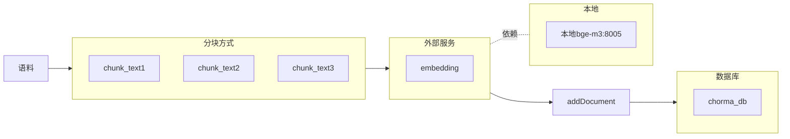
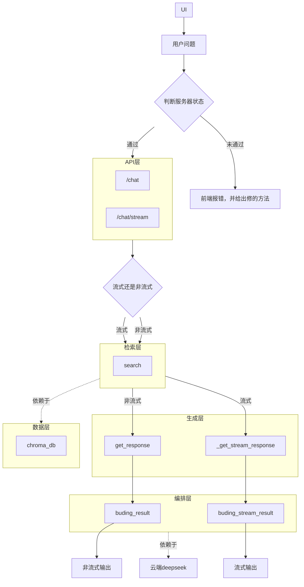

## 完善一下day06的内容

开始：2026年10月16日14:46:22

1.在流式输出这里遇到点问题，我更改的文件是day05.py，我原本打算直接在这个文件的_get_response（）中直接加个stream判断条件，让他在stream为True的时候走yaield，为False的时候走return，但是在http://127.0.0.1:8000/docs中测试发现他返回的answer为[]。

原因是：有yaield的函数会被标注为生成器函数，return的值会被放进**StopIteration.value**里。

但是我走yaield那条路的时候也返回的[],猜测是我在fastapi那里没有正确的消费迭代器，一会儿验证一下（确实是）。

2.解决方案：我原来打算直接让_get_response()返回response，然后再由get_response()消费response，但是问ai可行性时，他告诉我@retry()对迭代器不是很友好，所以选择新建一个方法。

3.最后写完是写完了但他的流式输出内容为：data: "仅"data: "凭"data: "你"data: "提供的"data: "这部分"data: "《"data: "乌"data: "合"。有这种数据就可以在前端流式输出了吗？2026年10月16日17:38:38

2026年10月18日14:17:06

day06AC收尾。

1.改掉了那个异步阻塞的post

2.为_get_stream_response()增加失败时的处理，为buding_stream_result加else，写了降级文本。

3.我老是忘开向量化模型，所以给在用到day06A里用到向量化大模型的部分的上游加上了更友好的报错提示。

2026年10月18日15:54

2026年10月20日19:40:29

收窄向量模型，首先我查看了自己的输出信息，将添加进向量库的source_path通过os.path.basename()变为了只有文件名的形式.然后添加了Citation这个模型，只传俩个变量，变量sourc_path和chnk_num.在通过serach()给的数据创建citation()的时候我遇到了不缺定字典的k键的情况，除了查原来的代码，还有什么更好的办法吗？

4.删掉了死字段和死参数。

5.重写了一下两数之和。

2026年10月20日 21:36

## 开始day07的任务

开始：2026年10月22日18:21:43

1.改了ai给的的ui代码，并成功跑通。

2.streamlit每次交互都会从头跑代码，相同的内容不会重新渲染，st.write_stream(生成器)消费SSE。

结束：2026年10月22日19:41:27

开始：2026年10月23日12:26:32

3.首先画离线的的架构图

4.然后画在线的架构图

结束：2026年10月23日14:04:07

开始：2026年10月24日13:31:18

5.那个deepwiki补丁我没找到改的，而且我发现那个代码里不知道是我让ai改的还是原来程序自己有的，存在许多类型不匹配。

6.简历M1在DSHprint\简历M1.doc中。

7.卡点我印象里都是关于语法，api用法之类的。

8.我找不到你说的代码随想录，所以第二题我做的合并两个有序数组。我把他放到了src\practice\algorithm\day02.py中。

结束:2026年10月24日14:58:36。
